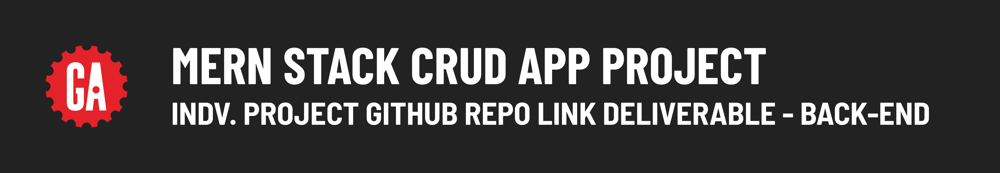

# 

## Introduction

After your project proposal has been approved, you'll need to set up a GitHub repo for the back-end of your project.

> 🚨 As a reminder, you should use the same repo or keep all the repos you use for the entire duration of your project to meet the project requirements.

## Submitting your GitHub repo link

Submit a link to the ***public*** GitHub repo that you are using for the back-end of your MERN Stack CRUD App Project.
